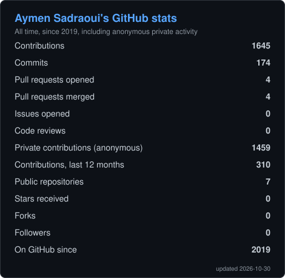
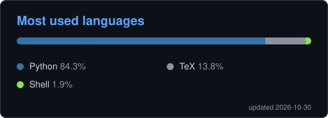

<h1 align="center">Aymen Sadraoui, Ph.D.</h1>
<h3 align="center">Data Scientist &amp; Machine Learning Engineer · Computer Vision · MLOps</h3>

  
  
  

---

## 👋 About me

I am a Data Scientist and Machine Learning Engineer with a **PhD in Machine Learning and Artificial Intelligence** from CentraleSupélec, Université Paris-Saclay. My background is in medical image analysis: I have designed and deployed deep learning models and scalable data pipelines for high-dimensional, multimodal data, from gigapixel histopathology slides to radiology scans (CT, MRI, X-ray). I currently work at **Deemea** (Paris, France).

The methods behind that work are domain-agnostic: computer vision, representation learning, data engineering, MLOps and rigorous model evaluation. I am open to applying them to new challenges across industries.

| | |
|---|---|
| 🔭 **Working on** | End-to-end data ingestion and processing pipelines, and deep learning models for quality control, segmentation and classification, deployed as containerized services in production |
| 🌱 **Learning** | MLOps and cloud deployment: moving models from prototype to monitored, scalable production systems |
| 🤝 **Open to collaborate on** | Applied AI and computer vision in any sector, few-shot learning and learning from limited labeled data, research that turns advanced methods into reliable products |
| 🔎 **Looking for** | Roles in data science, machine learning engineering, AI engineering and MLOps |
| 💬 **Ask me about** | Deep learning and computer vision, production-grade data pipelines, MLOps best practices, turning optimization algorithms into neural networks, moving from academic research to industry |
| ⚡ **Distinction** | 🥇 1st place out of 256 teams, Lung Transplant Rejection data challenge (Hôpital Foch &amp; Health Data Hub, 2024) |

---

## 🛠️ Tech stack

**Languages &amp; ML**

**MLOps, serving &amp; DevOps**

**Data &amp; visualization**

**Also:** ETL/ELT pipelines · model calibration · data-drift detection · out-of-distribution generalization · CI/CD

---

## 🚀 Featured projects

| Project | What it is | Stack |
|---|---|---|
| [**MyOllama**](https://github.com/aymenSadraoui/MyOllama) | Fully local LLM chatbot: FastAPI backend and Streamlit UI on top of Ollama (Qwen 2.5 3B), no cloud API needed | Python · FastAPI · Streamlit · Ollama · uv |

> More projects are coming. Browse my [repositories](https://github.com/aymenSadraoui?tab=repositories) for the rest.

---

## 📊 GitHub stats

  

  

These cards are generated by a [GitHub Action](.github/workflows/metrics.yml) that runs every day, so they are always current. No third-party image server is involved at view time.

---

## 🐍 Contribution graph

  <picture>
    <source media="(prefers-color-scheme: dark)" srcset="https://raw.githubusercontent.com/aymenSadraoui/aymenSadraoui/output/github-snake-dark.svg" />
    <source media="(prefers-color-scheme: light)" srcset="https://raw.githubusercontent.com/aymenSadraoui/aymenSadraoui/output/github-snake.svg" />
    
  </picture>

---

  Open to opportunities in data science, ML engineering, AI engineering and MLOps. Feel free to reach out.

